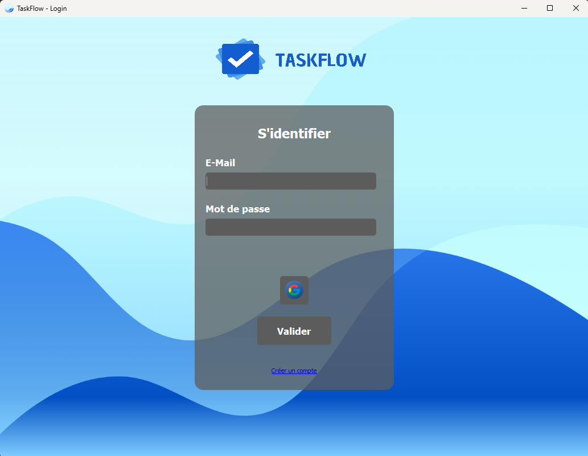
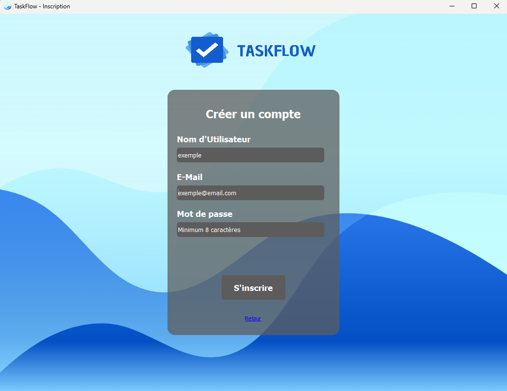

<div align="center">
  
</div>
<br />
<div align="center">
  <a href="https://github.com/votre-utilisateur/taskflow">
  
  </a>

  <h3 align="center">TaskFlow</h3>

  <p align="center">
    Une application collaborative de gestion de projets et de tâches.
    <br />
    <a href=https://github.com/zzendor/SAE502-TaskFlow/tree/main/docs><strong>Explorez les docs »</strong></a>
    <br />
    <br />
  </p>
</div>

<!-- TABLE OF CONTENTS -->
<details>
  <summary>Table des matières</summary>
  <ol>
    <li>
      <a>À propos du projet</a>
      <ul>
        <li><a href="#fonctionnalités-principales">Fonctionnalités principales</a></li>
      </ul>
    </li>
    <li>
      <a href="#installation">Installation</a>
      <ul>
        <li><a href="#prérequis">Prérequis</a></li>
        <li><a href="#installation-des-dépendances">Installation des dépendances</a></li>
      </ul>
    </li>
    <li><a href="#utilisation">Utilisation</a></li>
    <li><a href="#remerciements">Remerciements</a></li>
  </ol>
</details>

<!-- ABOUT THE PROJECT -->
## À propos du projet
TaskFlow est une application collaborative de gestion de projets et de tâches, développée en Python. Elle a été créée dans le cadre d'une **SAE** (Situation d'Apprentissage et d'Évaluation) par un groupe de 8 étudiants, dans le but de fournir une solution simple et efficace pour la gestion de projets en équipe. L'application permet de créer et de gérer des projets, d'attribuer des tâches, de suivre les progrès et de recevoir des rappels pour ne jamais manquer une échéance. Grâce à son interface conviviale et à ses fonctionnalités intelligentes, TaskFlow facilite l'organisation et la collaboration au sein des équipes de travail.

### Fonctionnalités principales

- **Gestion des projets** : Créez et gérez vos projets facilement.
- **Suivi des tâches** : Attribuez des tâches et sous tâches aux membres de l'équipe .
- **Rappels automatisés** : Notifications par e-mail pour les deadlines proches ou dépassées.
- **Interface utilisateur intuitive** : Une expérience fluide pour tous les utilisateurs.

### Captures d'écran

<div align="center">
  
  <p><em>Page d'acceuil</em></p>
  
  <div align="center">
  
  <p><em>Page de création de compte</em></p>


  
  <p><em>Interface de gestion des tâches</em></p>
</div>

<!-- INSTALLATION -->
## Installation

### Prérequis

- Python 3.9+
- Miniconda
- 
  

### Installation des dépendances

1. Clonez ce dépôt :
   ```bash
   git clone https://github.com/zzendor/SAE502-TaskFlow.git
   ```

2. Installez les dépendances :
   ```bash
  conda install --file requirements.txt
   ```

etc..... a vous de remplir


5. Lancez l'application :
   ```bash
   python manage.py runserver
   ```

<!-- USAGE -->
## Utilisation

1. **Connexion** : Créez un compte ou connectez-vous.
2. **Création de projet** : Ajoutez un projet et invitez des membres de votre équipe.
3. **Gestion des tâches** : Créez des tâches, attribuez-les et fixez des deadlines.
4. **Rappels automatisés** : Les utilisateurs reçoivent des rappels par e-mail pour les tâches proches de leur échéance ou en retard.

<!-- CONTRIBUTING -->


## Remerciements

Merci à tous les contributeurs et utilisateurs pour leur soutien continu à TaskFlow !
